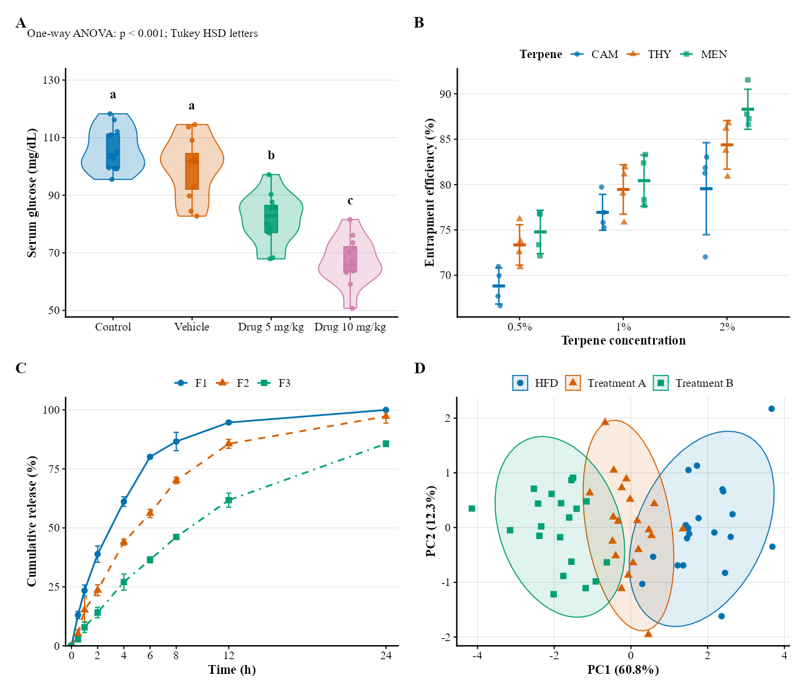
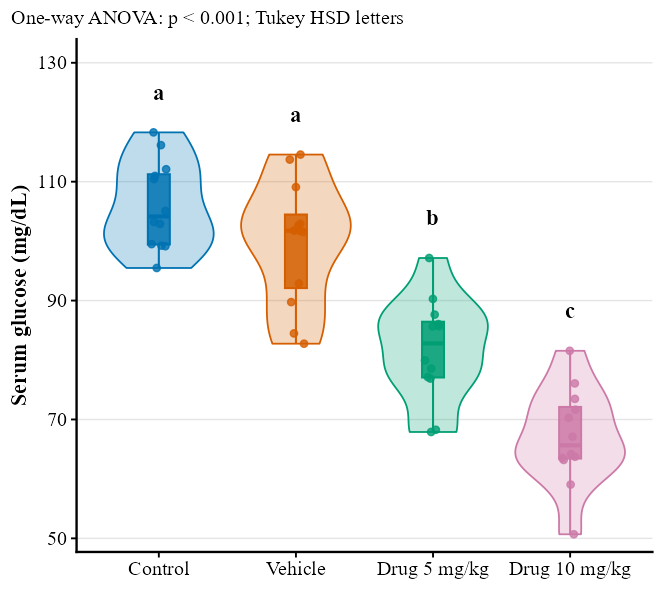
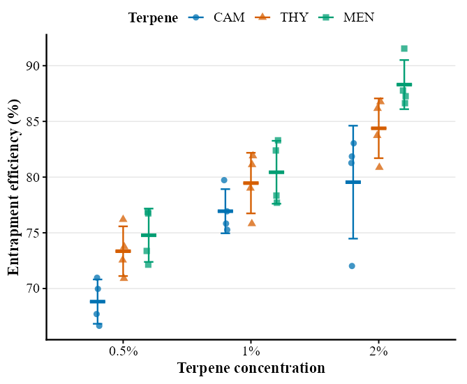
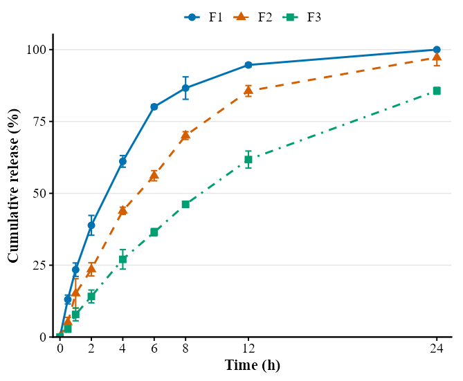
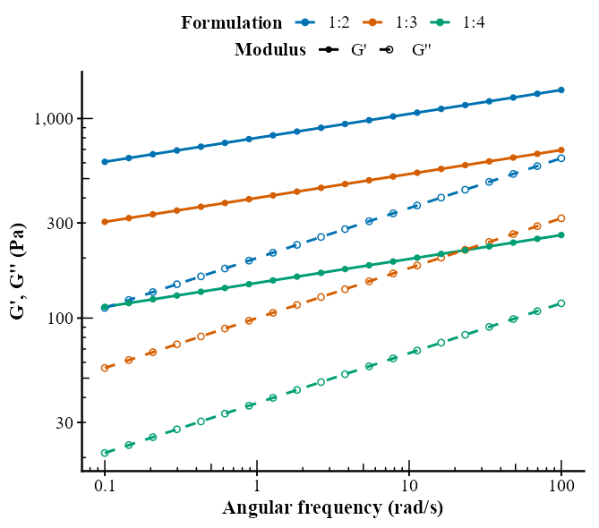
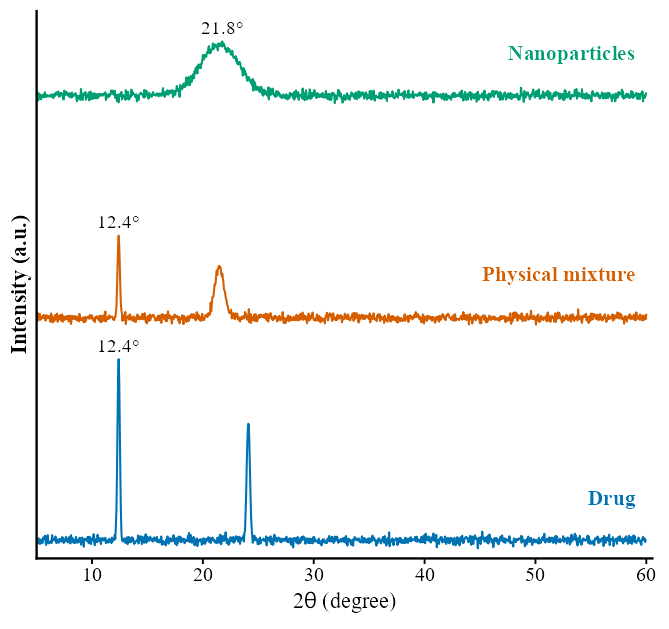
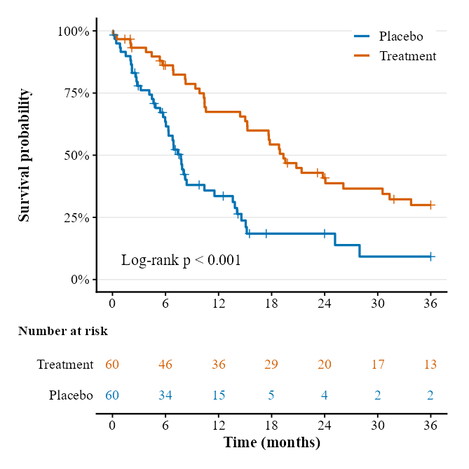
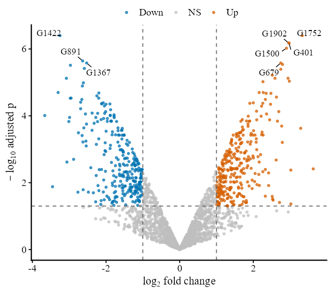
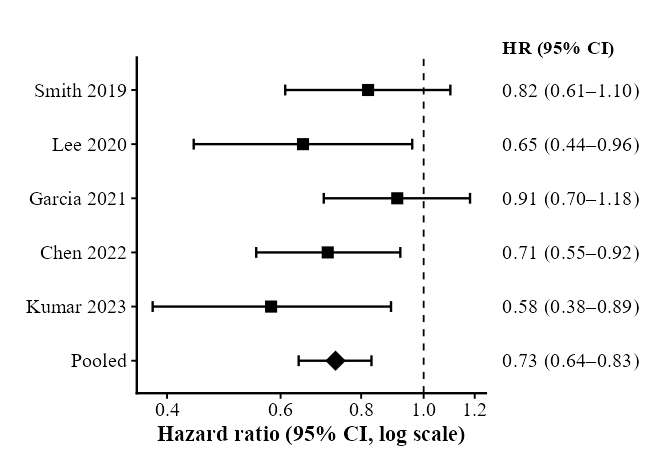
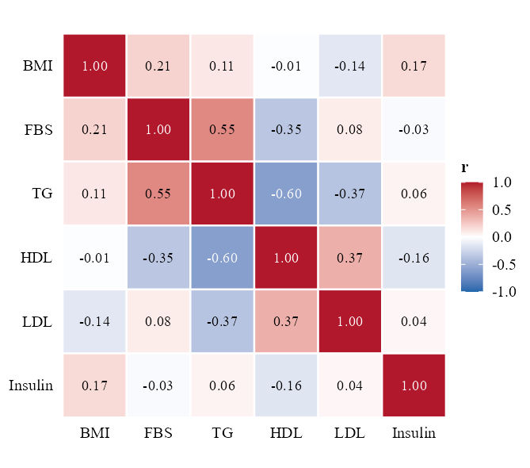

# gg-figs

A [Claude](https://claude.com) Agent Skill for **publication-quality scientific figures in R with ggplot2**.

Give Claude a data file (CSV, TSV, Excel) and ask for a figure. The skill inspects the data, chooses an appropriate
chart, adds only the statistics the analysis supports, and exports journal-ready files. It asks a question only
when two choices are equally defensible, for example violins vs. points for n = 4 per group.



## What it does

- **Reads the data first.** `scripts/inspect_data.R` detects column roles, replicates per group, wide vs. long
  layout, facet variables, labels that encode two factors (e.g. `"CAM 0.5%"`), paired designs, summary-only tables
  and existing p-value columns. It then ranks chart suggestions and lists any open questions.
- **Chooses the chart from the data.** The skill covers violin + box + points, points + mean ± SD,
  summary-only error bars, bars, paired lines, time courses, calibration/regression, rheology log-log overlays,
  XRD/FTIR/DSC/TGA curves, Kaplan–Meier with a risk table, volcano, forest, correlation heatmap, PCA and
  multi-panel plates.
- **Reports statistics carefully.** `compare_groups()` runs ANOVA + Tukey, Welch + Games-Howell or
  Kruskal–Wallis + Dunn, and `cld_letters()` turns the results into compact letters. Annotations are shown only
  when a named test supports them.
- **Keeps a consistent house style.** The theme sizes text for the final print size. The default palette is
  based on Okabe–Ito (readable with color blindness), and every color also has a matching shape or linetype for
  grayscale printing. The default font is Times New Roman (switch with `pub_font("Arial")`).
- **Exports for journals.** `save_pub()` writes vector PDF plus 600-dpi LZW TIFF and PNG at column widths for
  Elsevier, Springer Nature, Nature, Cell, ACS, Wiley, PLOS, Science and MDPI.
- **Drafts a caption** that defines the plot elements, error bars, n and the test used.

## Install

**Claude Code (all projects):**

```bash
git clone https://github.com/Erfanz97/gg-figs.git ~/.claude/skills/gg-figs
```

**Claude Code (one project):** clone into `<project>/.claude/skills/gg-figs`.

**Claude.ai / Claude Desktop:** download the repository as a ZIP and upload it under *Settings → Capabilities → Skills*.

**R packages:**

```r
install.packages(c("ggplot2", "dplyr", "tidyr", "readr", "patchwork", "ragg", "scales",
                   "systemfonts", "multcompView", "ggsignif", "readxl", "ggrepel", "survival"))
```

These were tested with R 4.5 and ggplot2 4.0.1. ggplot2 ≥ 3.5 should also work.

## Use

Ask in plain language, in any language. For example:

- "Make a figure for my paper from `data/ee_raw.csv`."
- "Plot the release profiles in `release.xlsx`, same style as my other figures."
- «از این فایل اکسل یک نمودار مناسب مقاله بکش»

Claude runs the inspector, states the chart it picked and why (or asks a short question when the data are
ambiguous), writes an R script in your project, renders the figure, checks it visually, and reports the files and
a draft caption.

You can use the helper library on its own, without Claude:

```r
source("R/gg_pub.R")            # copied from assets/gg_pub.R
st <- compare_groups(d, "value", "group")
p <- ggplot(d, aes(group, value, fill = group, color = group)) +
  layers_violin_box() +
  theme_pub(legend = "none")
save_pub(p, "Figure_01", width = "single", journal = "elsevier")
```

## Repository layout

| Path | Purpose |
|---|---|
| `SKILL.md` | Instructions Claude follows (workflow, decision rules, style, pitfalls) |
| `assets/gg_pub.R` | Helper library: `theme_pub`, palettes, `compare_groups`, `cld_letters`, layer bundles, `save_pub` |
| `assets/figure_template.R` | Skeleton for a project figure script |
| `scripts/inspect_data.R` | Data profiler and chart recommender |
| `references/` | Chart selection, recipes, statistics, journal specifications |
| `examples/demo.R` | Every recipe, run on simulated data, written to `examples/gallery/` |
| `examples/test_helpers.R` | Assertion tests (Tukey/Dunn/Games-Howell checked against `TukeyHSD()` and `rstatix`) |

Run the checks from the repository root:

```bash
Rscript examples/test_helpers.R
```

```bash
Rscript examples/demo.R
```

## Gallery

| | | |
|---|---|---|
|  |  |  |
|  |  |  |
|  |  |  |

All example data are simulated.

---

## خلاصه فارسی

این اسکیل به Claude کمک می‌کند با R و ggplot2 نمودارهای استاندارد مقاله بکشد. فایل داده (CSV یا اکسل) را بدهید.
Claude ساختار داده را بررسی می‌کند و نوع نمودار را خودش انتخاب می‌کند. فقط وقتی انتخاب واقعاً دوپهلو باشد سؤال
می‌پرسد. آزمون آماری مناسب و حروف معناداری را فقط وقتی نشان می‌دهد که تحلیل از آن پشتیبانی کند. خروجی PDF برداری و
TIFF و PNG با کیفیت ۶۰۰ dpi و در عرض ستون مجله است.
